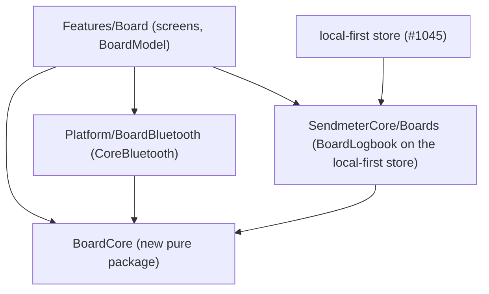

# Board tab — architecture (#1047)

## Summary

Decision: The Board tab sets up your wall, brings in your own logbook and routes from a file the maker sends you, lights a route and logs sends. It never contacts a maker or Boardsesh, uses none of their files, shares nothing between users, and keeps everything on the phone and in your private iCloud. No maker app has an export button, so the file comes by email request: Aurora (Tension, and old Kilter accounts) sends one JSON file, Moon sends spreadsheet files, and the new Kilter app has no known file yet, so it gets no import in v1. A logbook file names climbs but has no holds: your history shows at once, and a route can be lit once it is one you set or you have marked its holds. Which light sits behind which hold comes from a short wiring rule we write from each maker's public installation guide, proven on your wall by a one-minute check in setup; if the check fails you teach the app your wall, and until then nothing is lit.
Slices: a pure board package (types, the two lighting formats, connection logic, wiring rules and check, the two file readers); the Bluetooth link; the tab with setup, own routes, lighting and sends; the import screen; release paperwork. Fifteen issues.
Open questions: (1) Which real boards can you reach to test on? A board's wiring rule is only called checked after a real wall confirms it. (2) Can you ask Aurora and Moon for your own export now? The two file readers are designed from second-hand descriptions and each needs one real file to finish; replies can take weeks.

## What is here

| File | Read it for |
|---|---|
| [`adr.md`](adr.md) | The question, what the research found, the options, the decision, the legal and App Store risk |
| [`imports.md`](imports.md) | How a user gets their data out of each maker, the file formats, how the phone reads them |
| [`data-shapes.md`](data-shapes.md) | Board, layout, hold, route, angle, send; the LED map; the import types |
| [`statecharts.md`](statecharts.md) | The board link, the wiring check, an import, the lit route |
| [`protocols.md`](protocols.md) | The two lighting wire formats with test vectors, the LED order per board, what is unverified on hardware |

This README is the builder's map: how callers read, which module may call which, and the issues in order.

## Callers' usage, first

The Board tab reads like this. Everything below the tab is designed to make these lines true.

Bring in a file the maker sent:

```swift
let preview = try BoardImport.read(bytes, as: .auroraExport(board: .tension), onto: setup)
show(preview.sends.count, preview.routes.count, preview.skipped)

let result = try await logbook.apply(preview.plan(excluding: knownIDs))
```

Set a route, or mark the holds of an imported one:

```swift
var draft = RouteDraft(layout: setup.layout)
draft.toggle(hold.cell, role: .start)
try await logbook.save(draft.named("Proj", grade: Grade(label: "6C")))
```

Light it, or say why not:

```swift
switch Lighting.plan(route, on: setup) {
case .ready(let frame): try await board.light(frame, as: route.ref)
case .blocked(let why): explain(why)
}
```

Log the send:

```swift
try await logbook.save(
    Send(route: .snapshot(of: route), setup: setup, outcome: .sent(tries: 2),
         sessionID: workout.liveSessionID, climbedAt: now)
)
```

The pure core underneath, which is what the tests drive:

```swift
let writes = try Lighting.encoder(for: setup, link: traits).writes(for: frame)

var link = BoardLinkMachine()
let commands = link.handle(.light(writes, token: token))

var check = WiringCheck(layout: layout)
let next = check.handle(.answered(.hole(cell)))
```

`board.litRoute` (a route reference and the time it was lit) is the one value #1048 reads to tag attempts.

## Module boundaries



| Module | Path | May import | Must not |
|---|---|---|---|
| `BoardCore` (new package) | `native-plugins/board-core/` | Foundation only | CoreBluetooth, GRDB, SwiftUI, URLSession, any other package of ours |
| `SendmeterCore` boards code | `native/SendmeterNative/Sources/Core/Boards/` | `BoardCore`, the local-first store | CoreBluetooth, URLSession |
| `BoardBluetooth` | `native/SendmeterNative/Sources/Platform/` | `BoardCore`, CoreBluetooth | decide anything: it turns `BoardLinkCommand`s into CoreBluetooth calls and callbacks into `BoardLinkEvent`s |
| Board screens, `BoardModel` | `native/SendmeterNative/Sources/Features/Board/` | all of the above | build bytes, parse a file, call CoreBluetooth, make a network request |

Rules that follow from the table:

- **No module in this feature makes a network request.** There is no board client under `Sources/Data`.
- Every decision (encoding, chunking, the write queue, what a dropped link means, which LED to probe
  next, what a file's row means, whether a route can be lit) is a pure type in `BoardCore`, tested on
  the host. The Bluetooth class and the screens hold no policy.
- The import screen's only job is the system file picker: it hands the file's bytes to
  `BoardImport.read` and the confirmed plan to `BoardLogbook.apply`.
- `TindeqBluetooth` is not touched. The board link owns a second `CBCentralManager`.
- `BoardModel` is its own observable type. `AppModel.swift`, `SendmeterNativeApp.swift` and
  `Models.swift` are edited once, in issue 8, to add the tab; no board type goes into `Models.swift`.
- `BoardSetup`, `Route` and `Send` are stored and synced by the local-first store from #1045 through
  the `BoardLogbook` protocol, to the user's private iCloud database only.
- The watch does not link `BoardCore` in v1. It stays Foundation-only so #1048 can use `RouteRef` there.

## Implementation issues, in order

Each is one PR. "Proves by" is the gate that must be green; anything Bluetooth is device-only on top.

| # | Issue | Scope | Proves by | Waits on |
|---|---|---|---|---|
| 1 | board-core: package and domain types | New package `native-plugins/board-core`: the board, layout, hold, route, setup and send types in `data-shapes.md`; the six MoonBoard layouts in `Boards/`; `just board-core`; its own workflow file `.github/workflows/board-core.yml` (Linux `swift test`); coverage wiring; one repo-map line in `CLAUDE.md` | `just board-core` | — |
| 2 | board-core: MoonBoard lighting | Grid to LED index for 18 and 12 rows, the ASCII message, flags, 20-byte chunking, the vectors in `protocols.md` | `just board-core` | 1 |
| 3 | board-core: Aurora-wire lighting | API level from the advertised name, level 2 and level 3 encoding, the level 2 power budget, framing, chunking, vectors | `just board-core` | 1 |
| 4 | board-core: link state machine | `BoardLinkMachine` as a pure reducer: scan, connect, the write queue, drops; tests for out-of-order and concurrent events | `just board-core` | 1 |
| 5 | board-core: wiring rules and the wiring check | `WiringRule`, `LEDMap`, `Lighting.plan`, the `WiringCheck` reducer (probe, fit, teach); the five Tension Board 2 layouts, each rule written from its LED kit instructions | `just board-core` | 1 |
| 6 | board-core: Kilter layouts | One file per Kilter layout, each rule written from its "LED Layout Map" handbook; a layout whose map cannot be read ships with no rule | `just board-core` | 5 |
| 7 | native: board Bluetooth link | `BoardBluetooth` driving the reducer; the Bluetooth purpose string in `Info.plist` reworded to cover board lights; a debug screen that lights one LED by index | `just gen`, `just build-ios`; device checklist below | 2, 3, 4 |
| 8 | native: board records and the Board tab | `BoardLogbook` on the local-first store; `AppTab.board`; add a wall (board, layout, angle) | `just core`, `just build-ios` | #1045 store, #1046 design |
| 9 | native: wiring check screen | The drawn board; probe, fit and teach on the real wall; the result saved in the setup | `just build-ios`; device | 5, 7, 8 |
| 10 | native: set and light your own route | Hold picker on the drawn board, save, light, clear, the reasons a route cannot be lit; `litRoute` published | `just core`, `just build-ios`; device | 9 |
| 11 | native: log a send | Send sheet, the logbook list, the link to the live session | `just core`, `just build-ios` | 8 |
| 12 | board-core: Aurora export reader | `BoardImport` for the Aurora file, ids from content, `AuroraCoordinates` for the layouts a real file and wall have proven; starts by correcting `imports.md` from a real file; test fixtures are synthetic | `just board-core` | 1, open question 2 |
| 13 | board-core: Moon logbook reader | Header matching by name, the two encodings, tries and angle parsing; same start from a real file | `just board-core` | 1, open question 2 |
| 14 | native: import screen | How to get your file for each board (with the mail draft), the file picker, the preview, apply; mark holds on a name-only route | `just core`, `just build-ios` | 10, 11, 12, 13 |
| 15 | release: board paperwork | Reviewer notes and demo video script, App Store copy rules from `adr.md`, privacy answers, release notes | `just docs-check` | 14 |

Issues 1 to 7 need nothing from #1045 or #1046 and can start as soon as this ADR is approved. 12 and 13
can be written against `imports.md` before a real file arrives but do not merge until one has been read.
#1048 (attempt to route) starts after 10.

## Device-only checks

None of this can be shown in a simulator or in CI. Each Bluetooth issue reports it as device-only, with
the board model and controller named.

- Scan finds the board; connect; one LED lights by index; clear works.
- The wiring check on each layout we can reach: the shipped rule passes, or the fit finds the right
  order; the layout file is then marked `checkedOnWall` in a PR naming the wall.
- A route lights the right holds in the right colours.
- Aurora-wire: a level 3 box and, if one can be found, a level 2 box (bare name, write-with-response only).
- MoonBoard: a standard and a Mini board; whether the `~D*` flag and an empty message behave as documented.
- A second route tapped while the first is still being written: the board ends on the second, never a mix.
- Walking out of range and back: the link reports the drop, reconnects, and relights on request.
- Tindeq connected at the same time as a board.
