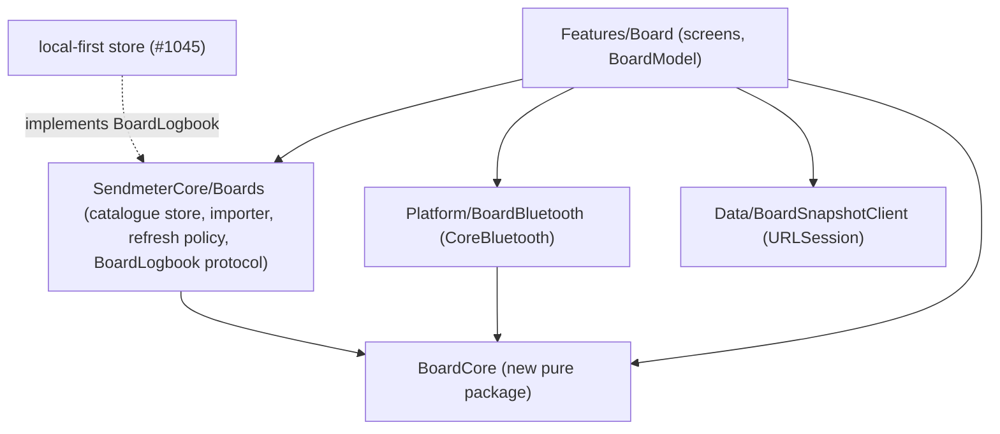

# Board tab — architecture (#1047)

## Summary

Decision: Sendmeter never talks to a board maker's servers. Kilter left Aurora in March 2026, and both Aurora's (Tension) and Kilter's terms forbid third-party access. Setup, lighting, your own routes and sends work on all three boards with no outside service. The Kilter and Tension catalogue comes from the public route files the Boardsesh project publishes, downloaded on the phone when the user asks. MoonBoard routes are entered by the user.
Slices: a pure board package (types, both lighting protocols, connection logic); the Bluetooth link; MoonBoard end to end; then, behind the owner gate, the board hardware map, the catalogue download and search, and the release paperwork. Twelve issues.
Open questions: (1) Owner gate: approve the Boardsesh route files as the Kilter and Tension catalogue (recommended, can be per board), or ship user-entered routes only until a maker gives permission? (2) MoonBoard catalogue from the same files: off in v1 (recommended; Moon says it does not share its data) or on?

## What is here

| File | Read it for |
|---|---|
| [`adr.md`](adr.md) | The question, what the research found, the options, the decision, the legal and App Store risk |
| [`data-shapes.md`](data-shapes.md) | Board, layout, hold, route, angle, send; the catalogue database schema |
| [`statecharts.md`](statecharts.md) | The board link, the catalogue, the lit route |
| [`protocols.md`](protocols.md) | The two lighting wire formats with test vectors, and what is unverified on hardware |

This README is the builder's map: how callers read, which module may call which, and the issues in order.

## Callers' usage, first

The Board tab reads like this. Everything below the tab is designed to make these lines true.

```swift
let routes = try await catalogue.routes(
    matching: RouteQuery(angle: setup.angle, grades: .v(3) ... .v(6), text: "crimp", sort: .mostClimbed),
    page: .first
)

let frame = try hardware.frame(for: route, on: setup)
try await board.light(frame, as: route.ref)

try await logbook.save(
    Send(route: .snapshot(of: route), setup: setup.id, angle: setup.angle,
         outcome: .sent(tries: 2), sessionID: workout.liveSessionID, climbedAt: now)
)
```

A route the user sets themselves (the only kind on MoonBoard in v1, available on every board):

```swift
var draft = RouteDraft(layout: setup.layout)
draft.toggle(hold, role: .start)
let route = try await logbook.save(draft.named("Proj", grade: .font("6C")))
```

The pure core underneath, which is what the tests drive:

```swift
let encoder = BoardDescriptor.of(setup.kind).encoder(link: traits, setup: setup)
let writes = try encoder.writes(for: frame)

var link = BoardLinkMachine()
let commands = link.handle(.light(writes, token: token))
```

`board.litRoute` (a route reference and the time it was lit) is the one value #1048 reads to tag attempts.

## Module boundaries



| Module | Path | May import | Must not |
|---|---|---|---|
| `BoardCore` (new package) | `native-plugins/board-core/` | Foundation only | CoreBluetooth, GRDB, SwiftUI, any other package of ours |
| `SendmeterCore` boards code | `native/SendmeterNative/Sources/Core/Boards/` | `BoardCore`, GRDB | CoreBluetooth, URLSession |
| `BoardSnapshotClient` | `native/SendmeterNative/Sources/Data/` | Foundation | parse or interpret a file: it returns a file URL and the manifest values |
| `BoardBluetooth` | `native/SendmeterNative/Sources/Platform/` | `BoardCore`, CoreBluetooth | decide anything: it turns `BoardLinkCommand`s into CoreBluetooth calls and callbacks into `BoardLinkEvent`s |
| Board screens, `BoardModel` | `native/SendmeterNative/Sources/Features/Board/` | all of the above | build bytes, run SQL, call CoreBluetooth |

Rules that follow from the table:

- Every decision (encoding, chunking, the write queue, what a dropped link means, when to refresh the
  catalogue, which snapshot is acceptable) is a pure type in `BoardCore` or `SendmeterCore`, tested on
  the host. The Bluetooth class and the download client hold no policy.
- `TindeqBluetooth` is not touched. The board link owns a second `CBCentralManager`.
- `BoardModel` is its own observable type. `AppModel.swift`, `SendmeterNativeApp.swift` and
  `Models.swift` are edited once, in issue 6, to add the tab; no board type goes into `Models.swift`.
- User records (`BoardSetup`, the user's routes, `Send`) are stored and synced by the local-first store
  from #1045 through the `BoardLogbook` protocol. The catalogue and the hardware map are separate SQLite
  files that never sync and are excluded from backup: they can be downloaded again.
- The watch does not link `BoardCore` in v1. It stays Foundation-only so #1048 can use `RouteRef` there.

## Implementation issues, in order

Each is one PR. "Proves by" is the gate that must be green; anything Bluetooth is device-only on top.

| # | Issue | Scope | Proves by | Waits on |
|---|---|---|---|---|
| 1 | board-core: package and domain types | New package `native-plugins/board-core`: the types in `data-shapes.md`, `BoardDescriptor` per board in `Boards/`, `just board-core`, its own workflow file `.github/workflows/board-core.yml` (Linux `swift test`), coverage wiring, one repo-map line in `CLAUDE.md` | `just board-core` | — |
| 2 | board-core: MoonBoard lighting | Grid to LED index for 18 and 12 rows, the ASCII message, flags, 20-byte chunking, the vectors in `protocols.md` | `just board-core` | 1 |
| 3 | board-core: Aurora-wire lighting | Frames-string parser, API level from the advertised name, level 2 and level 3 encoding, the level 2 power budget, framing, chunking, vectors | `just board-core` | 1 |
| 4 | board-core: link state machine | `BoardLinkMachine` as a pure reducer: scan, connect, the write queue, drops; tests for out-of-order and concurrent events | `just board-core` | 1 |
| 5 | native: board Bluetooth link | `BoardBluetooth` driving the reducer; the Bluetooth purpose string in `Info.plist` reworded to cover board lights; a debug screen that lights a fixed pattern | `just gen`, `just build-ios`; device checklist below | 2, 3, 4 |
| 6 | native: board records and the Board tab | `BoardSetup`, user routes and `Send` behind `BoardLogbook` on the local-first store; `AppTab.board`; MoonBoard setup (size, angle, LEDs above holds) | `just core`, `just build-ios` | #1045 store, #1046 design |
| 7 | native: set and light your own route | Hold picker on the schematic board, save, light, clear; `litRoute` published | `just core`, `just build-ios`; device | 5, 6 |
| 8 | native: log a send | Send sheet, the logbook list, the link to the live session | `just core`, `just build-ios` | 6 |
| — | **Owner gate: catalogue source (open question 1)** | | | |
| 9 | native: board hardware map | Snapshot manifest client, hardware importer, `BoardHardwareStore`; Kilter and Tension setup (layout, size, hold sets, angle); own routes and lighting on those boards | `just core`, `just build-ios`; device | 7, gate |
| 10 | native: catalogue store | Layout snapshot download, validation, import, `BoardCatalogueStore` queries and search, refresh policy; fixtures are synthetic, built in the tests | `just core` | 9 |
| 11 | native: browse, search and light the catalogue | Route list, filters, detail, light, send from a catalogue route; update and delete the catalogue, credits, in Settings | `just core`, `just build-ios`; device | 8, 10 |
| 12 | release: board paperwork | Reviewer notes and demo video script, App Store copy rules from `adr.md`, privacy answers, release notes | `just docs-check` | 11 |

Issues 1 to 4 need nothing from #1045 or #1046 and can start as soon as this ADR is approved. #1048
(attempt to route) starts after 7.

## Device-only checks

None of this can be shown in a simulator or in CI. Each Bluetooth issue reports it as device-only, with
the board model and controller named.

- Scan finds the board; connect; a route lights with the right holds and colours; clear works.
- Aurora-wire: a level 3 box and, if one can be found, a level 2 box (bare name, write-with-response only).
- MoonBoard: a standard and a Mini board; whether the `~D*` flag and an empty message behave as documented.
- A second route tapped while the first is still being written: the board ends on the second, never a mix.
- Walking out of range and back: the link reports the drop, reconnects, and relights on request.
- Tindeq connected at the same time as a board.
