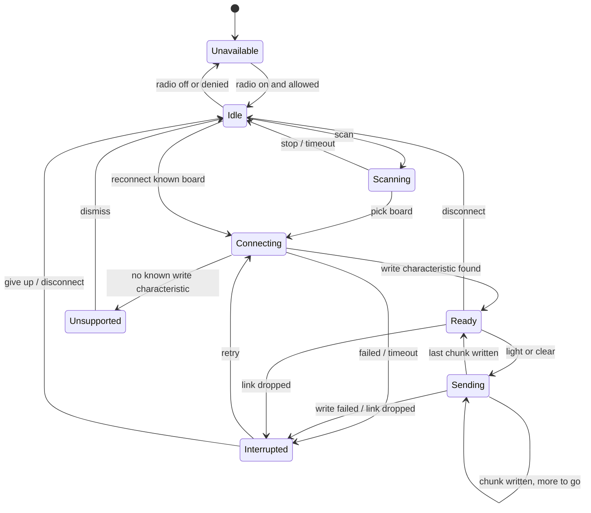
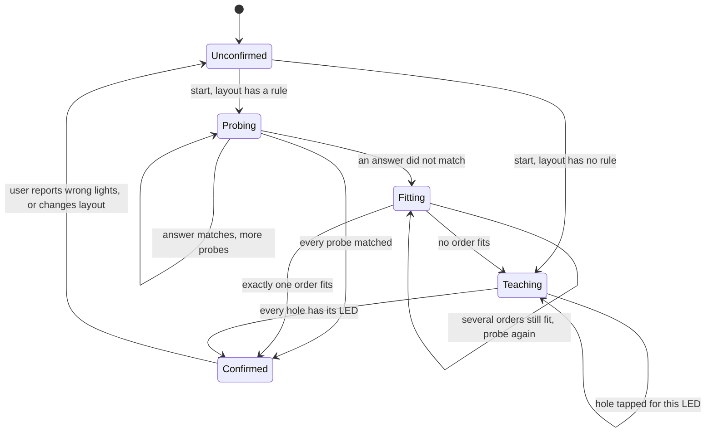
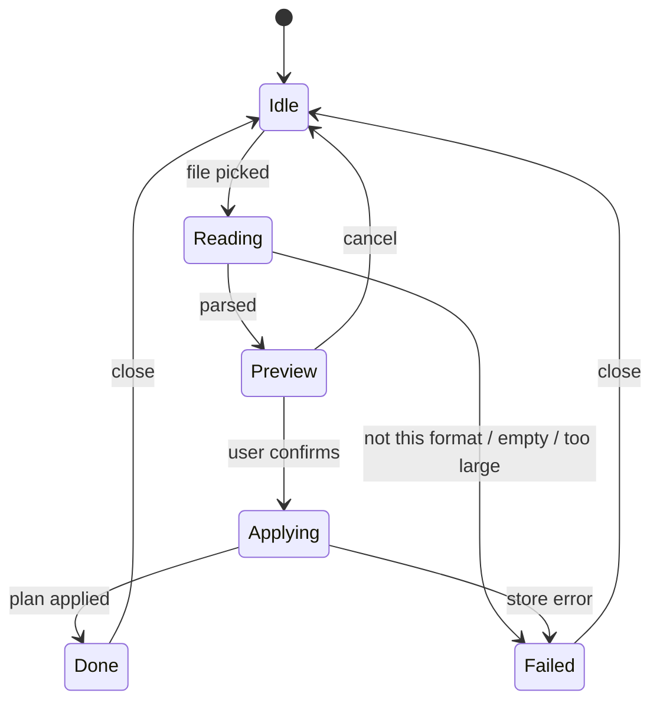
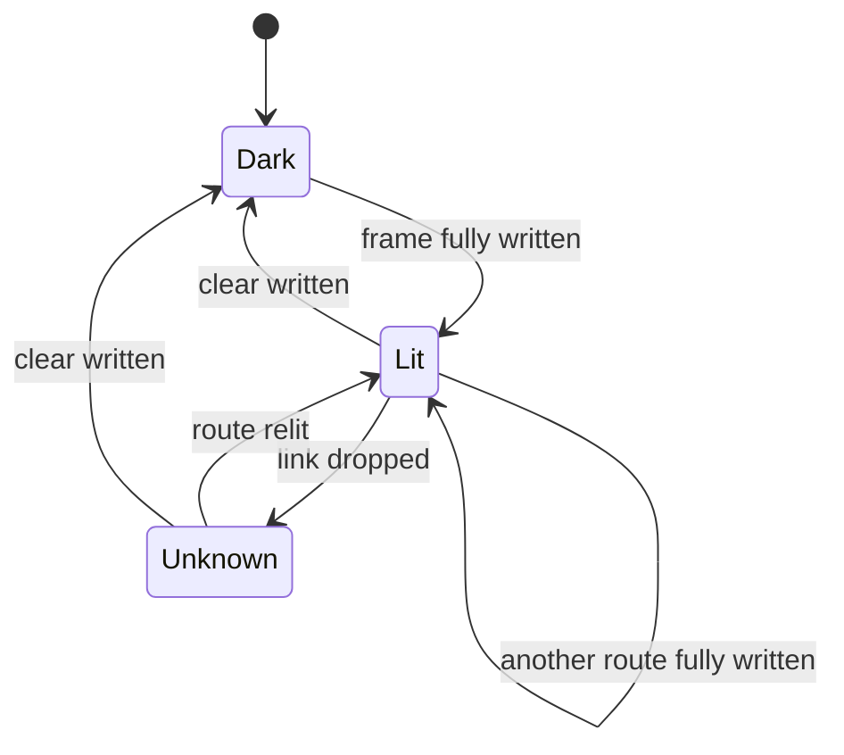

# Statecharts (#1047)

Four pieces of state matter. Each is a pure reducer with host tests; the screens only render them.

## 1. The board link

`BoardLinkMachine` in `BoardCore`. Events come from CoreBluetooth callbacks and from the user;
commands go back to `BoardBluetooth`. The machine never awaits: it takes one event and returns
commands, so no decision is made from a value captured before a suspension.



```swift
public enum BoardLinkState: Equatable, Sendable {
    case unavailable(RadioProblem)
    case idle
    case scanning(found: [DiscoveredBoard])
    case connecting(DiscoveredBoard.ID)
    case ready(LinkTraits)
    case sending(LinkTraits, remaining: Int)
    case interrupted(LinkDrop)
    case unsupported(UnsupportedBoard)
}
```

Rules the tests pin:

- **One frame at a time, latest wins.** A `light` that arrives while `Sending` replaces any waiting
  request and starts only after the frame in flight has written its last chunk. Chunks of two frames
  never interleave.
- **A token names each request.** A write callback carrying an old token is ignored.
- **A drop clears the queue.** Nothing is replayed on reconnect unless the user asks; the board keeps
  showing what it last received.
- **Write type is chosen once per connection** from the characteristic's properties: with response
  when offered, without response (paced by the system's ready signal) only when it is the sole option.
- `Unsupported` covers a MoonBoard "Pro" box and any board whose services match nothing known.

## 2. The wiring check (per wall)

`WiringCheck` in `BoardCore`. It decides which LED to light next and what the user's answer means; the
result is the setup's `LEDMapSource`. A probe lights one LED; the user taps the hole that lit on the
drawn board, or "nothing lit".



- **Probing** uses the layout's shipped rule and a handful of probes chosen to tell it from its
  near-misses: the first LED, the last, the far end of the first run, each strand's first LED.
- **Fitting** tries the other threading orders (the four start corners, both directions, one or two
  LEDs per hold, an index offset) against every answer so far, and asks for the probe that splits the
  survivors. It ends with one order, stored as `.rule`, or none.
- **Teaching** walks the LEDs in order. After two taps in a line it proposes the rest of that run for
  one tap to accept. The result is stored as `.taught`.
- Progress is part of the state value and is saved with the setup, so leaving the screen or losing the
  link resumes where it stopped. Probes are sent only while the link is `Ready`.
- Until `Confirmed`, `Lighting.plan` returns `.blocked(.wiringUnconfirmed)`: the probes are the only
  thing that lights.
- Every MoonBoard goes through `Probing` too, with two probes: a home wall can be threaded differently
  from the guide.

## 3. An import

`ImportFlow` in `BoardCore`, driven by the import screen.



- `Reading` runs off the main actor on the file's bytes; the flow holds a token so a second file picked
  meanwhile replaces the first and a late result is dropped.
- `Preview` shows what is new (records whose id the store does not have), what is already there, and
  each skipped entry with its reason. Nothing is written before `Applying`.
- `Applying` is one store transaction: it ends with everything in the plan added, or nothing.
- Running the same file again reaches `Preview` with nothing new.

## 4. The lit route

Held by `BoardModel`; derived from the link, not stored.



```swift
public enum LitRoute: Equatable, Sendable {
    case dark
    case lit(RouteRef, since: Date)
    case unknown(last: RouteRef)
}
```

- `since` is the moment the last chunk was acknowledged, read from an injected clock. #1048 tags every
  attempt that starts after it with that route, until the next `lit`.
- `unknown` keeps the route for tagging (the board is still showing it) and tells the screen it cannot
  confirm it.
- A wiring-check probe is not a route: it never changes `LitRoute`.
