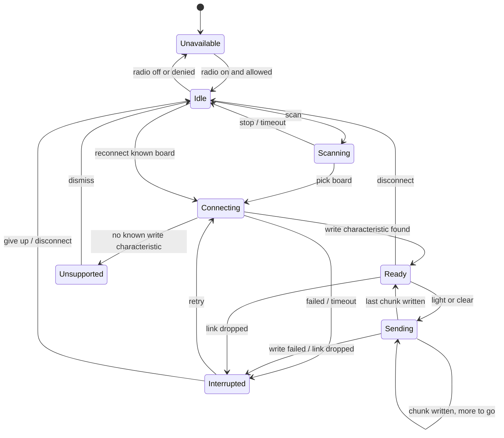
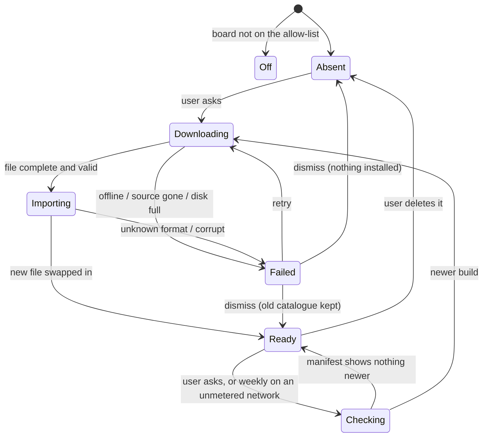
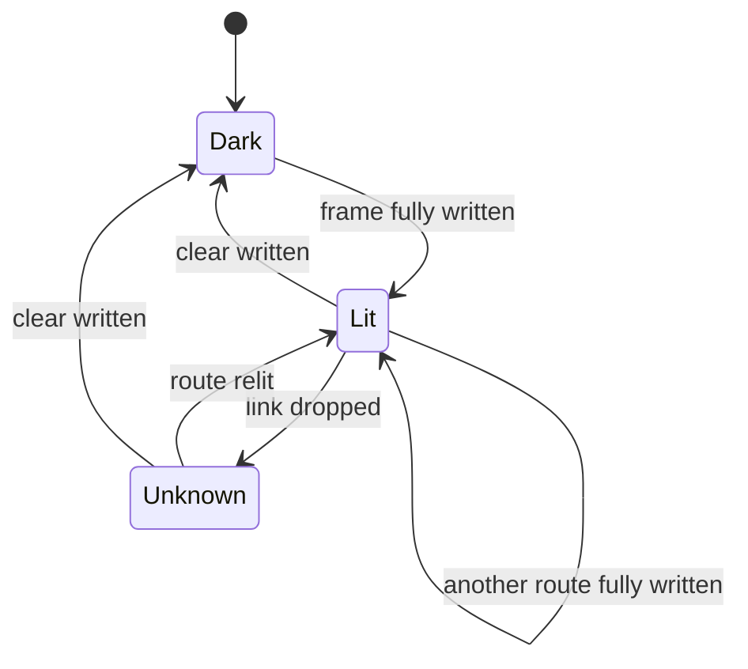

# Statecharts (#1047)

Three pieces of state matter. Each is a pure reducer with host tests; the screens only render them.

## 1. The board link

`BoardLinkMachine` in `BoardCore`. Events come from CoreBluetooth callbacks and from the user;
commands go back to `BoardBluetooth`. The machine never awaits: it takes one event and returns
commands, so no decision is made from a value captured before a suspension.



```swift
public enum BoardLinkState: Equatable, Sendable {
    case unavailable(RadioProblem)
    case idle
    case scanning(found: [DiscoveredBoard])
    case connecting(DiscoveredBoard.ID)
    case ready(LinkTraits)
    case sending(LinkTraits, remaining: Int)
    case interrupted(LinkDrop)
    case unsupported(UnsupportedBoard)
}
```

Rules the tests pin:

- **One frame at a time, latest wins.** A `light` that arrives while `Sending` replaces any waiting
  request and starts only after the frame in flight has written its last chunk. Chunks of two frames
  never interleave.
- **A token names each request.** A write callback carrying an old token is ignored.
- **A drop clears the queue.** Nothing is replayed on reconnect unless the user asks; the board keeps
  showing what it last received.
- **Write type is chosen once per connection** from the characteristic's properties: with response
  when offered, without response (paced by the system's ready signal) only when it is the sole option.
- `Unsupported` covers a MoonBoard "Pro" box and any board whose services match nothing known.

## 2. The catalogue (per layout) and the hardware map

`CatalogueRefresh` in `SendmeterCore`. The store on disk is the truth; this is the progress around it.



- `Ready` stays usable through `Checking`, `Downloading`, `Importing` and `Failed`: the old file is
  replaced only by a complete new one, by rename.
- A download is accepted only if the manifest entry is a known format, its privacy marker is the
  expected value, the byte count matches, SQLite's quick check passes and the row counts match.
- `source gone` (the manifest or file is missing) is a normal state with its own message, since the
  publisher may stop. `unknown format` asks for an app update.
- Automatic checks: at most one manifest request a day, a download at most weekly, never on a metered
  or constrained network. A download is always resumable and cancellable.
- The hardware map follows the same chart with one file for all boards; setting up a Kilter or Tension
  wall needs it `Ready`.

## 3. The lit route

Held by `BoardModel`; derived from the link, not stored.



```swift
public enum LitRoute: Equatable, Sendable {
    case dark
    case lit(RouteRef, since: Date)
    case unknown(last: RouteRef)
}
```

- `since` is the moment the last chunk was acknowledged, read from an injected clock. #1048 tags every
  attempt that starts after it with that route, until the next `lit`.
- `unknown` keeps the route for tagging (the board is still showing it) and tells the screen it cannot
  confirm it.
