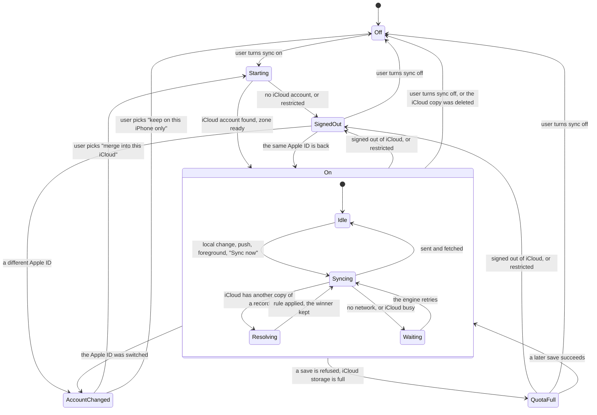

# Sync: statechart and conflict rules

Sync is off until the user turns it on. In every state below, local reads and writes work and nothing waits on
the network.



| State | Sends | Fetches | Settings shows |
|---|---|---|---|
| Off | no | no | "On this iPhone only" |
| Starting | no | no | "Turning on…" |
| On · Idle | when there is a change | on push | "Synced" and the time |
| On · Syncing | yes | yes | "Syncing…" |
| On · Resolving | paused for those records | yes | "Syncing…" (a conflict is never shown) |
| On · Waiting | retried by the engine | retried | "Waiting for network" |
| QuotaFull | no; changes queue locally | yes | "iCloud storage is full", the count not sent, "Try again" |
| SignedOut | no; changes queue locally | no | "Sign in to iCloud in Settings to sync" |
| AccountChanged | no | no | A choice: merge this iPhone's data into the new iCloud, or keep it local and turn sync off |

Notes:

- Turning sync off keeps both copies. "Delete iCloud copy" is its own confirmed action: it deletes the zone,
  and every other device then goes to Off with its local data kept.
- "The iCloud copy was deleted" covers the user clearing it in iOS Settings (zone purged) and another device's
  "Delete iCloud copy". Local data is never deleted because the cloud copy went away.
- An encrypted-data reset re-sends every row; the state stays On.
- QuotaFull retries on foreground, once a day, and on "Try again".
- Turning on for the first time sends every row never sent; rows already in the zone are merged by the rules
  below. Imported rows keep their ids, so two devices that imported the same account do not duplicate.

## The state as a type (`Core/Sync`, pure, host-tested)

```swift
public enum SyncState: Equatable, Sendable {
    case off
    case starting
    case on(Activity)                          // .idle(lastSynced: Date?), .syncing, .resolving(Int), .waiting
    case quotaFull(unsent: Int)
    case signedOut(Reason)                     // .noAccount, .restricted
    case accountChanged
}

public enum SyncEvent: Equatable, Sendable {
    case userTurnedOn, userTurnedOff, userChoseMerge, userChoseLocalOnly, userAskedRetry
    case account(AccountStatus)                // .available(sameAppleID: Bool), .none, .restricted
    case zoneReady, localChange, sent, fetched
    case conflicted(Int), resolved
    case failed(SendFailure)                   // .quota, .network, .cloudCopyDeleted
}

public func reduce(_ state: SyncState, _ event: SyncEvent) -> (SyncState, [SyncEffect])
```

`SyncEffect` is what the transport must do next (`start`, `stop`, `sendPending`, `fetch`, `resendAll`,
`forgetAppleID`). The `CKSyncEngine` adapter in `Data/CloudKit` turns engine events into `SyncEvent`s and runs
the effects; it holds no rule.

## Conflict rules

A conflict is a save the server refuses because its record changed since this device last saw it. The rule is
picked by the table's `sync_table.rule`:

| Rule | Tables | What happens |
|---|---|---|
| `last_edit` | sessions, workouts, attempts, recordings, tags, presets, routines, phase periods, settings | The copy with the later `updated_at` wins, whole record. A tie keeps iCloud's. If the local copy wins it is sent again over the server's change tag |
| `written_once` | recording samples, workout traces | iCloud's copy is kept. The two are the same by construction: the id is made once, on the device that recorded |
| `health` | health metrics | By day: a row with source data beats one without (the no-empty-day guard of `HealthMetricPrecedence`); between two with source data the later `computed_at` wins. Both devices read the same HealthKit, so they converge |

Across records:

- **Permanent delete beats edit.** Saving an edit to a record that was deleted elsewhere fails as unknown; the
  local row is removed. A soft delete (`deleted_at`) is an ordinary edit, so restore works across devices.
- **A parent's delete removes its children** locally in one transaction; their deletes are sent too.
- **Tags** are keyed by name, so two devices creating the same tag meet in one record. A rename writes the new
  name, moves the recordings and deletes the old name in one transaction.
- **One open phase period.** After remote changes are applied, if two periods are open, the one with the later
  `started_on` stays open (tie: the larger id) and each other one is closed the day the next begins;
  `user_settings` is then set from the open period. It runs in the same transaction as the apply.

The watch is not a sync peer. Its health record goes through `HealthMetricPrecedence.decide(writer: .watch)` on
the phone at ingest, unchanged: the watch fills only a stale or empty day.

Each rule is a pure function in `Core/Sync` with a host test that runs two stores against a fake transport and
asserts both end equal.
