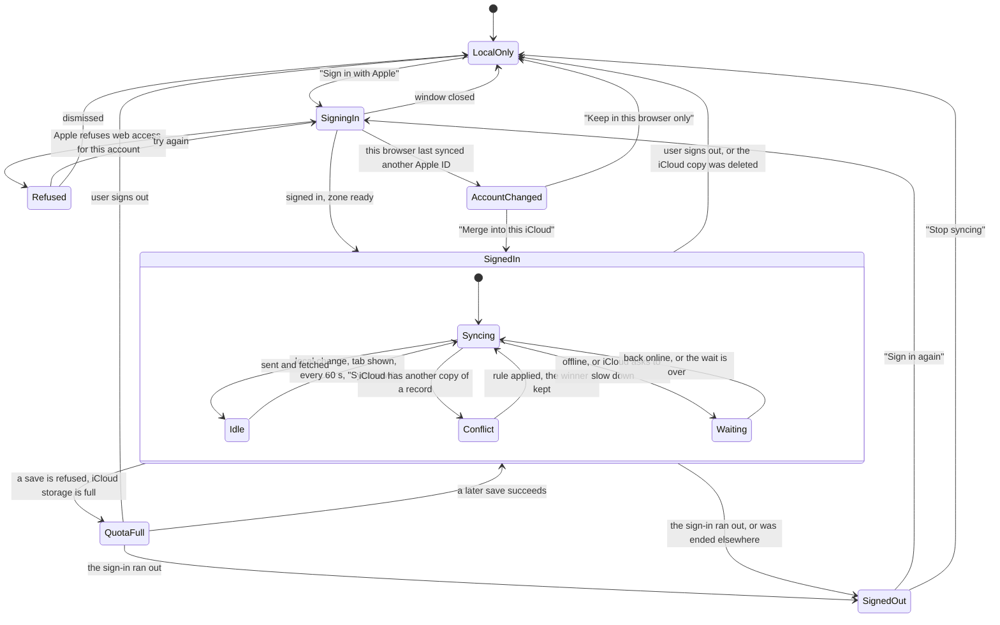

# Sync: one rule set, two transports

Sync is off until the user turns it on (phone) or signs in (web). In every state, on both platforms, local
reads and writes work and nothing waits on the network. #1045's conflict rules are kept word for word
(`local-first/sync.md`): last edit wins by `updated_at`, samples and traces are written once, the health rule,
a permanent delete beats an edit, the one-open-phase repair. They move from Swift to `sm-sync`.

## Who does what

| Job | Phone | Web | Shared? |
|---|---|---|---|
| Which rows are pending | `sm-sync`, from the store's change log | the same | yes |
| Row ↔ record, field names and types | `sm-sync` (`CloudRecord`) | the same | yes |
| Conflict rules, the phase repair | `sm-sync` | the same | yes |
| The sync state and what Settings says | `sm-sync` (`SyncState`, `reduce`) | the same | yes |
| Batches: at most 100 records and 900 KB each | `sm-sync` | the same | yes |
| When to send and fetch, retry and back-off | `CKSyncEngine` | the poll engine in `sm-sync::poll` | no |
| Where the server's place is remembered | the engine's saved state, kept in `sync_meta` | the zone's change token, kept in `sync_meta` | no |
| Hearing of a remote change | a silent push | a fetch when the tab is shown, every 60 s while open, after each send | no |
| The account | the engine's account events | CloudKit JS sign-in and its token | no |
| `CloudRecord` ↔ the platform's record | `CloudKitTransport` (Swift) | `cloud.ts` | no: mechanical, fixture-tested |

Everything in a "no" row is plumbing. A transport makes no decision about data.

## How the two stay consistent

1. **One writer of fields.** Both transports get records as `CloudRecord` from Rust: the same names, the same
   types. The web always sends each field with its explicit type, because CloudKit JS guesses `INT64` for a
   whole-number `DOUBLE` such as an RPE of 7 and the save then fails.
2. **One schema file.** `just gen-cloudkit` writes `cloudkit/schema.ckdb` from the store's table list. It is
   committed and checked (`generated` in `arch.toml`); the owner imports and deploys it. No one edits the
   schema by hand in the console.
3. **One set of transport fixtures.** `fixtures/cloud/` holds a `CloudRecord` for every record type (empty
   fields, non-ASCII text, the largest bytes) and a table of server errors. A simulator test turns each into a
   `CKRecord` and back; a node test turns each into CloudKit JS's record object and back. Both must return what
   they were given, and both must map every error in the table to the same `Failed` or `TransportFailure`.
4. **One rule suite.** `cargo test -p sm-sync` runs two stores against a fake transport through every rule and
   every edge of the statechart, and asserts both stores end equal. It is the same code on both platforms, so
   it runs once.
5. **One real check.** A phone and a browser on one throwaway Apple ID: an edit on each reaches the other.
   Device-only; the owner's.

Error table (part of the fixtures):

| Server says (native / web) | Core gets |
|---|---|
| `serverRecordChanged` / `CONFLICT` | `Failed::Conflict` with the server's record |
| `unknownItem` / `NOT_FOUND` | `Failed::Unknown`: deleted elsewhere, the local row goes |
| `quotaExceeded` / `QUOTA_EXCEEDED` | `Failed::Quota` |
| `zoneNotFound`, `userDeletedZone` / `ZONE_NOT_FOUND` | `ZoneGone` |
| `notAuthenticated` / `AUTHENTICATION_REQUIRED` | `Account(None)` on the phone, `Account(Expired)` on the web |
| — / `ACCESS_DENIED` on the private database, or a refused sign-in | `Account(Refused)` |
| `networkUnavailable`, `networkFailure` / a failed request | `TransportFailure::Network` |
| `requestRateLimited`, `serviceUnavailable` / `THROTTLED`, `TRY_AGAIN_LATER` | `TransportFailure::Throttled` |
| `limitExceeded` / a request too large | the core halves the batch and sends again |

## The state as a type (`sm-sync`, pure, host-tested)

```rust
pub enum SyncState {
    Off,                                   // phone: "On this iPhone only"; web: local-only
    Starting,                              // phone: account and zone; web: the sign-in window, then the zone
    On(Activity),                          // Idle { last_synced }, Syncing, Resolving(n), Waiting(why)
    QuotaFull { unsent: u32 },
    SignedOut(Why),                        // NoAccount, Restricted (phone); Expired (web)
    AccountChanged,
    Refused(RefusedWhy),                   // web: WebAccessOff, AdvancedDataProtection, Unknown
}

pub fn reduce(state: &SyncState, event: &SyncEvent) -> (SyncState, Vec<CloudCommand>)
```

It is #1045's type with two additions for the web, `Refused` and `SignedOut(Expired)`. The phone's statechart
in `local-first/sync.md` is kept as drawn.

## Sync on the web



| Web state | `SyncState` | Sends | Fetches | Settings shows |
|---|---|---|---|---|
| LocalOnly | `Off` | no; no request leaves the site | no | "Only in this browser", Export, "Sign in with Apple" |
| SigningIn | `Starting` | no | no | "Signing in…" |
| SignedIn · Idle | `On(Idle)` | 2 s after a change | on show, every 60 s | "Synced" and the time |
| SignedIn · Syncing | `On(Syncing)` | yes | yes | "Syncing…" |
| SignedIn · Conflict | `On(Resolving)` | paused for those records | yes | "Syncing…" (a conflict is never shown) |
| SignedIn · Waiting | `On(Waiting)` | retried with back-off | retried | "Waiting for network" |
| QuotaFull | `QuotaFull` | no; changes queue in the store | yes | "iCloud storage is full", the count not sent, "Try again" |
| SignedOut | `SignedOut(Expired)` | no; changes queue | no | "Sign in again to sync" |
| AccountChanged | `AccountChanged` | no | no | A choice: merge this browser's data into this iCloud, or keep it here and stay signed out |
| Refused | `Refused` | no | no | Why, in plain words, and what to turn on (below) |

Notes:

- **Local-only is a full app.** With no Apple ID the web app logs, shows stats and sets routes from its own
  store. CloudKit JS is not even loaded until the user asks to sign in.
- **Signing in is turning sync on.** The first sync sends every row never sent and merges what the zone holds
  by the rules, exactly as the phone's first turn-on does.
- **Signing out** asks: keep this browser's copy, or remove it. A shared computer needs the second.
- **Conflict** is a moment inside syncing, settled by rule; the user never sees a question.
- **The account** is CloudKit's user record name, the same value on the phone and the web for one Apple ID,
  kept in `sync_meta.apple_id`.
- **Sealed fields** never reach the web, and the web never writes a `health_metrics` record, so it cannot
  drop them.
- **A newer schema.** An unknown field is left on the server and ignored; an unknown record type is skipped.
  A migration that adds a synced table or column clears the saved place, so the next sync fetches the zone
  again and nothing skipped stays missing.

## What protects the data, and Advanced Data Protection

- Standard protection, for every user: encrypted in transit and at rest in iCloud, with keys Apple holds.
  Apple can read the plain fields; an app or person without the user's Apple ID cannot.
- Sealed fields (the recovery inputs) are in `encryptedValues`: end-to-end encrypted when the user has
  Advanced Data Protection, standard otherwise, and never on the web either way.
- **A user with Advanced Data Protection must turn on** Settings › [name] › iCloud › iCloud.com › **Allow Data
  Access** (before iOS 26.4: "Access iCloud Data on the Web"), then approve each web sign-in on a trusted
  device. Apple's page gives an approval one hour.
- **That may not be enough.** Apple documents the switch for iCloud.com. One public test found CloudKit JS
  sign-in refused for such an account with the switch on, and calls with an older token answered
  `ACCESS_DENIED` ("private db access disabled for this account"). If so, the web app shows `Refused` with
  "Web sync is not available for this Apple Account while Advanced Data Protection is on. Your data stays in
  this browser." and the phone is unaffected. Device-only; open question 2.
- Because nothing the web needs is an asset or a sealed field, an account that *is* let in reads everything.
