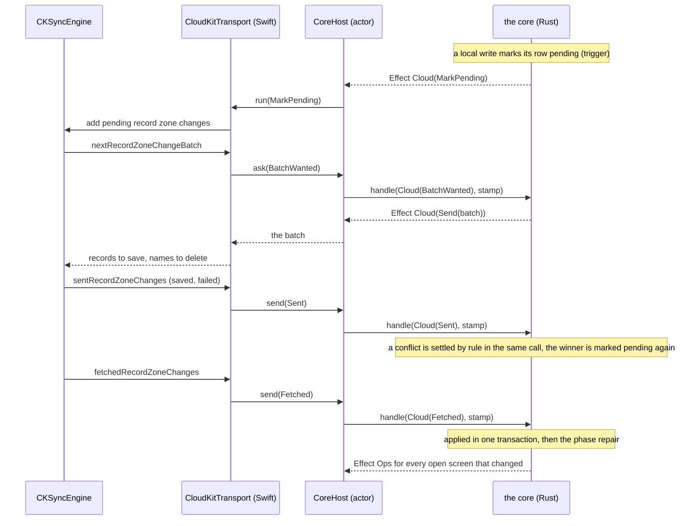
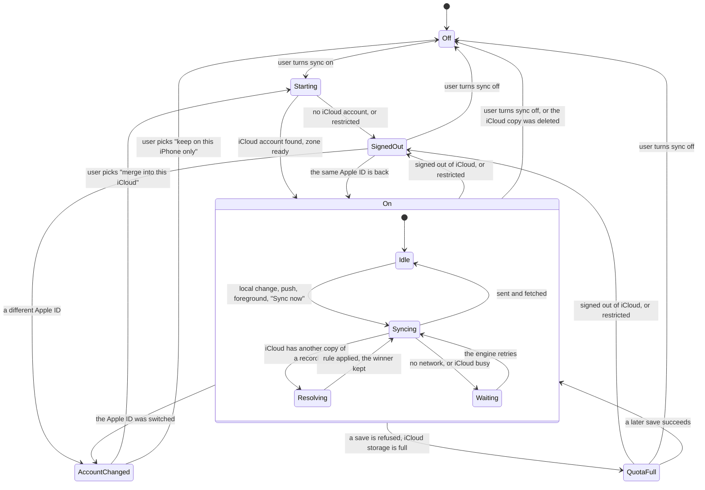

# Sync: the rules in Rust, CKSyncEngine as the transport

Sync is native iCloud only, between the user's iPhones, and off until the user turns it on. In every state
local reads and writes work and nothing waits on the network. #1045's design is kept
(`local-first/sync.md`): its statechart, its five conflict rules (last edit wins by `updated_at`, samples and
traces are written once, the health rule, a permanent delete beats an edit, the one-open-phase repair) and its
encryption. What changes is where the rules live: in `sm-sync`, not in Swift.

## Who does what

| Job | Where |
|---|---|
| Which rows are pending | `sm-sync`, from the store's change log |
| Row ↔ record: field names, types, the asset column | `sm-sync` (`CloudRecord`) |
| Conflict rules, the phase repair | `sm-sync` |
| The sync state and what Settings says | `sm-sync` (`SyncState`, `reduce`) |
| Batches: at most 100 records and 900 KB each | `sm-sync` |
| When to send and fetch, retry and back-off, pushes | `CKSyncEngine` |
| Where the server's place is remembered | the engine's saved state, kept by the core in `sync_meta` |
| The account | the engine's account events |
| `CloudRecord` ↔ `CKRecord`, `encryptedValues`, `CKAsset` files | `CloudKitTransport` (Swift): mechanical, fixture-tested |

The transport makes no decision about data.

## One turn



Every arrow into the core goes through `CoreHost`'s one queue, so a fetch, a tap and a Bluetooth packet are
never handled at the same time and never out of order.

## The state



This is #1045's chart, as approved. What each state sends, fetches and shows in Settings is #1045's table,
kept. As a type (`sm-sync`, pure, host-tested):

```rust
pub enum SyncState {
    Off,
    Starting,
    On(Activity),                          // Idle { last_synced }, Syncing, Resolving(n), Waiting
    QuotaFull { unsent: u32 },
    SignedOut(Why),                        // NoAccount, Restricted
    AccountChanged,
}

pub enum SyncEvent {
    UserTurnedOn, UserTurnedOff, UserChoseMerge, UserChoseLocalOnly, UserAskedRetry,
    Cloud(CloudEvent),                     // what the transport reported (shapes.md)
    LocalChange,
}

pub fn reduce(state: &SyncState, event: &SyncEvent) -> (SyncState, Vec<CloudCommand>)
```

`sm-app` feeds user asks and `CloudEvent`s to `reduce`, applies records through `sm-store`, puts the new
state into the Settings screen's input and returns the `CloudCommand`s as effects. The state is rebuilt from
`sync_meta` at `open`, so a relaunch resumes where it was.

## How the transport is held honest

1. **One writer of fields.** The transport gets every record as a `CloudRecord` from Rust and copies it: the
   same names and types on every phone and every build.
2. **Fixtures.** `fixtures/cloud/` holds a `CloudRecord` for every record type (empty fields, non-ASCII text,
   the largest asset) and a table of server errors. An app-target test turns each into a `CKRecord` and back
   and must return what it was given, and maps every error to the `Failed` or `TransportFailure` below.
3. **The rule suite.** `cargo test -p sm-sync` runs two stores against a fake transport through every rule and
   every edge of the statechart, and asserts both stores end equal.
4. **The real check.** Two phones on one throwaway Apple ID: an edit on each reaches the other. Device-only;
   the owner's.

| CloudKit says | The core gets |
|---|---|
| `serverRecordChanged` | `Failed::Conflict` with the server's record |
| `unknownItem` | `Failed::Unknown`: deleted elsewhere, the local row goes |
| `quotaExceeded` | `Failed::Quota` |
| `zoneNotFound`, `userDeletedZone` | `ZoneGone` |
| an account change to no account, or restricted | `Account(None)`, `Account(Restricted)` |
| `networkUnavailable`, `networkFailure`, `requestRateLimited`, `serviceUnavailable` | `TransportFailure::Network`; the engine retries by itself |
| `limitExceeded` | the core halves the batch for the next `BatchWanted` |

## Two phones on different builds

- A synced schema change is add-only: a new column or a new table, never a rename or a new meaning.
- A field the app does not know is kept on the record and ignored; a record type it does not know is skipped.
- A migration that adds a synced table or column clears the saved place, so the next sync fetches the zone
  again and nothing skipped stays missing.

## What protects the data

As #1045 decided, unchanged:

- Every value field is written through `encryptedValues`; the two heavy columns are `CKAsset`s. The data is
  in the user's private database, which the developer cannot read.
- With Advanced Data Protection on, the user's iCloud data is end-to-end encrypted; without it, Apple's
  standard protection applies. The user turns nothing on for Sendmeter either way.
- This issue's AC asked for plain fields and a list of what such users must turn on for web access. The owner
  dropped the web app (q3123), so no field is weakened and there is no web access to turn on. Health values
  stay on the phone and in the user's private iCloud.

Not verified here, device-only: `CKSyncEngine`, pushes, account changes, quota, Advanced Data Protection.
